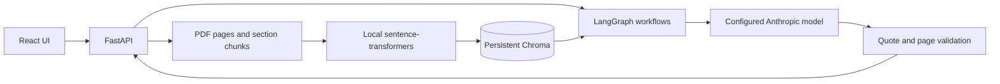

# PPA-Sense - Contract Intelligence Agent

A learning project for extracting commercial terms from renewable energy Power
Purchase Agreements (PPAs) and Engineering, Procurement and Construction (EPC)
contracts, and answering questions with source-page citations.

## Highlights

- Upload PDFs and retain physical page numbers through parsing, chunking, and search.
- Search each contract with local embeddings and persistent Chroma storage.
- Extract 14 commercial fields through a LangGraph workflow with evidence checks and retries.
- Ask questions and inspect clickable page citations in a React interface.
- Reproduce a **92.9% top-5 source-page hit rate (13/14 answerable questions)** on a
  public 123-page PPA. This is a small development-set retrieval result, not answer accuracy.

Generated-answer and extraction accuracy have not yet been measured with a live
provider. Scanned pages currently need OCR support. This is a local portfolio prototype,
with no authentication or production deployment claim.

## Architecture



## Quick start

For Docker, copy `.env.example` to `.env`, configure the model only if you want
generated answers, then run `docker compose up --build`. Open
[the app](http://127.0.0.1:5173) and [API docs](http://127.0.0.1:8000/docs).
Local indexing needs no paid API key; the current generation adapter uses Anthropic
and may incur provider charges. See the detailed setup and evaluation instructions below.

For development without Docker, follow the backend setup below and run `npm ci`
then `npm run dev` inside `frontend` in a second terminal.

See [contribution instructions](CONTRIBUTING.md) and [data handling](SECURITY.md).
GitHub Actions runs backend checks, frontend checks, and container builds. The source
PDF is downloaded from its public publisher when evaluating; it is not bundled here.

## Current scope: Step 9

Implemented: backend scaffold, typed configuration, health endpoint, Docker Compose,
page-aware PDF extraction, heading-aware chunks, local sentence-transformers embeddings,
and persistent Chroma search with document filtering and duplicate-free re-ingestion.
Also implemented: a LangGraph retrieval-to-answer pipeline, optional local reranking,
Anthropic integration, page/quote checks, and POST /api/answer. Step 5 adds typed
commercial-term extraction with field-level evidence, bounded retries, review flags,
and POST /api/extract. Step 6 adds background PDF uploads, document status, scoped
Q&A/extraction routes, and saved results. Step 7 adds a React workspace for uploads,
terms, clickable source quotes, and Q&A. See [frontend setup](frontend/README.md),
[Step 5 graph and usage](backend/app/agent/TERMS_WORKFLOW.md),
[Step 4 setup and explanations](backend/app/agent/README.md)
and [Step 3 search usage](backend/app/retrieval/README.md).

Step 8 packages both services with restricted build contexts, a non-root Python
process, runtime backend configuration, health checks, and persistent data volumes.

Step 9 adds a source-checked, 15-question development evaluation on a real public
123-page PPA, a local retrieval baseline, citation checks, and per-field extraction
rubrics. See [the dataset](evaluation/sonrisa-2019.json) and the evaluation section below.

Stack: Python, FastAPI, Pydantic, LangGraph, Anthropic API (model selected through
environment variables), ChromaDB, local sentence-transformers embeddings, React,
and Docker. Local indexing needs no API credentials. Generated answers require
ANTHROPIC_API_KEY and LLM_MODEL. First use of local embeddings downloads the selected
model; the health endpoint does not load it. Step 4 follows the explicit Anthropic
request, replacing the earlier Gemini plan.

## Structure

```text
backend/
  app/
    main.py          Application factory and router registration
    config.py        Typed environment configuration
    api/             HTTP routes, request handling, and status codes
    schemas/         Pydantic request and response contracts
    ingestion/       PDF parsing, page metadata, and section-aware chunking
    retrieval/       Local embeddings, persistent vector storage, and filtered search
    agent/           LangGraph answer/extraction workflows, Anthropic adapters, source checks
    evaluation/      Dataset validation, evaluation runner, and metric reporting
  tests/             Backend tests
  pyproject.toml     Package metadata, dependencies, and tool configuration
  Dockerfile         Backend container image
frontend/            React + TypeScript workspace, API client, browser tests
evaluation/          Source-checked questions, field rubrics, and baseline reports
.github/             Automated checks and issue/pull request templates
docker-compose.yml   Backend and frontend services with persistent volumes
.env.example         Configuration template without credentials
```

These are modules in one backend, not separate microservices. HTTP code should not
contain PDF parsing or provider-specific logic. Shared schemas define the boundaries,
so implementations can change without changing the client-facing API.

## Run locally (PowerShell, Python 3.11-3.13)

Run from the repository root:

```powershell
Copy-Item .env.example .env
python -m venv .venv
.\.venv\Scripts\python.exe -m pip install -e "./backend[dev]"
.\.venv\Scripts\python.exe -m uvicorn app.main:app --reload
```

Open http://127.0.0.1:8000/docs or http://127.0.0.1:8000/api/health.
The health route returns `{"status":"ok"}`. It reports process liveness only.
The root `.env` is read independently of the shell's working directory; environment
variables override file values. The retrieval CLI also reads embedding and Chroma
settings. The answer pipeline reads Anthropic settings when it is initialized.

Do not overwrite an existing `.env` when repeating setup. Never commit keys or PDFs.

## Check

```powershell
.\.venv\Scripts\python.exe -m pytest backend/tests
.\.venv\Scripts\python.exe -m ruff check backend
```

## Run with Docker

With Docker running, from the repository root:

```powershell
docker compose up --build
```

Docker Desktop must be running with Linux containers. Create the root `.env` from
`.env.example` only if it does not already exist, and edit it locally. No key is
required to upload/index; answer and extraction calls require the configured provider.
Stop any locally running servers on ports 5173 and 8000 before starting Compose.

To validate without printing resolved environment values, then run detached:

```powershell
docker compose config --quiet
docker compose up --build --detach --wait --wait-timeout 180
docker compose ps
```

Open http://127.0.0.1:5173 for the UI and http://127.0.0.1:8000/docs for the API.
The wait timeout concerns container health, not the initial image build or model
download. First ingestion downloads the embedding model if it is not cached.

The backend is exposed on localhost port 8000. Compose passes configuration into
the container and mounts persistent Chroma/model/document volumes. It does not copy your
`.env` into the image. Stop with `docker compose down`. Chroma is embedded in the
backend process; there is no separate Chroma server. The React frontend runs on
http://127.0.0.1:5173 and proxies API requests to the backend container.

### Backend Dockerfile, line by line

| Instruction | Meaning |
| --- | --- |
| `FROM python:3.12-slim` | Start from a small Linux image containing Python 3.12. |
| `ENV PYTHONDONTWRITEBYTECODE=1` | Avoid creating Python bytecode cache files. The backslash continues this instruction on the next line. |
| `PYTHONUNBUFFERED=1` | Send Python logs immediately to container output. |
| `WORKDIR /service/backend` | Set the directory used by the following commands. |
| `COPY pyproject.toml ./` | Copy the Python package/dependency definition. |
| `COPY app ./app` | Copy the backend source. |
| `RUN pip install --no-cache-dir .` | Install the backend package and runtime dependencies without retaining pip's download cache. |
| `RUN useradd --create-home --uid 10001 appuser` | Create an ordinary user with a predictable numeric ID. |
| `&& mkdir -p /service/data/chroma /service/data/documents /service/models` | In the same build step, create the three writable storage directories. |
| `&& chown -R appuser:appuser /service/data /service/models` | Give that user ownership of those directories. Fresh named volumes inherit their initial ownership. Existing volumes keep their existing permissions. |
| `USER appuser` | Run the backend without root privileges. |
| `EXPOSE 8000` | Document the container's API port; this alone does not publish a host port. |
| `CMD [...]` | Start Uvicorn on all container interfaces, port 8000, with exactly one worker. The JSON command form avoids a shell wrapper. One worker is required by the current in-process job/catalog design. |

The backend uses a single stage for simplicity. Its Python/ML dependencies are also
needed at runtime, so removing a build stage would not remove those runtime packages.

### Frontend Dockerfile, line by line

| Instruction | Meaning |
| --- | --- |
| `FROM node:22-alpine AS build` | Start a Node 22 build stage named `build`. |
| `WORKDIR /app` | Set its working directory. |
| `COPY package.json package-lock.json ./` | Copy dependency definitions first so Docker can reuse the dependency layer when only UI source changes. |
| `RUN npm ci` | Install dependencies using the committed lockfile, failing if it disagrees with the manifest. |
| `COPY index.html tsconfig.json vite.config.ts ./` | Copy the HTML entry point and build configuration. |
| `COPY src ./src` | Copy React source, without local environment files or test output. |
| `ENV VITE_API_BASE_URL=/backend` | Set a public browser URL prefix for the build. This is configuration, not a secret. |
| `RUN npm run build` | Check TypeScript and produce static HTML, JavaScript, and CSS in `dist`. |
| `FROM nginx:stable-alpine` | Start a separate final image with Nginx. Node, source, and build dependencies stay in the previous stage. |
| `COPY nginx.conf /etc/nginx/conf.d/default.conf` | Configure static file serving and the API proxy. |
| `COPY --from=build /app/dist /usr/share/nginx/html` | Copy only the compiled website from the build stage. |
| `EXPOSE 80` | Document the web server's container port. The base image already supplies the Nginx startup command. |

### Compose and request flow

Compose builds `frontend/` and `backend/` as separate images and joins them to a
default private network. Nginx can reach the API using the service name `backend`.
The browser cannot use that Docker-only hostname, so it calls `/backend/documents`
on port 5173. Nginx removes `/backend/` and forwards `/documents` to `backend:8000`.
Both browser UI and API calls use the same origin in this setup.

`127.0.0.1:5173:80` maps the local UI port to Nginx; `127.0.0.1:8000:8000` exposes
FastAPI locally for API docs/debugging. Neither mapping listens on the laptop's
external network interfaces. `init: true` adds a small process that forwards signals
and cleans up child processes. The backend gets up to 60 seconds to stop gracefully;
that does not guarantee every long job completes before shutdown.

`depends_on: condition: service_healthy` waits for the API's HTTP health check before
starting the frontend. Both checks run every 30 seconds, allow 5 seconds per check,
and tolerate 3 failures after an initial 10-second grace period. They check HTTP
liveness, not provider credentials, model availability, or job success. Health checks
alone do not restart unhealthy containers.

| Named volume | Container directory | What persists |
| --- | --- | --- |
| `chroma_data` | `/service/data/chroma` | Chunks, vectors, and retrieval metadata |
| `document_data` | `/service/data/documents` | Uploaded PDFs, SQLite catalog, saved extraction results |
| `embedding_models` | `/service/models` | Downloaded local model cache used through `HF_HOME` |

The top-level `volumes` section declares these Docker-managed volumes. Compose
creates them on first use and reuses them after container replacement. Ordinary
`docker compose down` preserves them; adding `--volumes` deletes them. Do not use
that option for a routine restart. Host `data/` files are not automatically copied
into named volumes. Keep the Compose project name stable to reuse the same volumes.
Back up document and Chroma storage together while no writes are running.

### Environment variables and secrets

Compose resolves `${NAME:-default}` from your shell or root `.env`, then passes only
the listed values to the backend at runtime. Shell values take precedence. The root
`.env` is outside both build contexts. Allowlist-based `.dockerignore` files also
exclude `.env` variants nested inside those contexts. Git ignores `.env` variants
while allowing `.env.example` templates. There are no provider keys in Dockerfile
`ARG`/`ENV` instructions or frontend build variables.

`VITE_` values become public JavaScript at build time. Changing a running container's
environment does not change an already-built frontend bundle. Backend provider keys
are runtime configuration; change `.env`, then recreate the backend with
`docker compose up -d backend`. Do not share the output of plain `docker compose config`
or container inspection: runtime environment values can be visible to Docker operators.
Use `config --quiet` for validation. Runtime environment injection keeps keys out of
images, but it is not a secret vault; production deployments should use a secret manager
or mounted secrets with explicit application support.

### Docker limits and verification

The current environment has no Docker executable, so container builds, Linux package
installation, Nginx startup, and volume permissions have not been runtime-tested here.
The Compose YAML, volume/path mappings, build inputs, and environment handling were
checked statically. Run the commands above on a Docker-enabled machine to verify.

At scale, Docker alone does not make jobs durable or allow several backend replicas.
Use a durable queue, separate ingestion workers, and shared document/vector storage.
Images and Python dependency ranges are not fully pinned; production builds should
pin image digests and lock Python dependencies. The frontend uses `package-lock.json`.
Existing root-owned volumes may need ownership migration to UID 10001 before this
non-root backend can write; back them up and migrate ownership instead of deleting them.

## Data flow

Upload: POST /documents -> save PDF + queued record -> HTTP 202 -> background ingestion
-> page-aware chunks -> embeddings -> Chroma -> ready/failed status in SQLite.

Implemented ingestion: PDF -> page-aware text -> section-aware chunks.
See [ingestion usage and design](backend/app/ingestion/README.md).
Implemented indexing: chunks -> local embeddings -> persistent Chroma.
Implemented search: question -> embedding -> document filter -> matching chunks.
Implemented questions: question -> retrieval -> optional rerank -> page evidence
-> LangGraph/Anthropic -> checked quotes and citation labels -> structured JSON.
React now supports uploads, extraction, citations, and Q&A. See the
[frontend setup and request flow](frontend/README.md). Re-ingest pre-Step-4 PDFs to add exact page offsets.

## Limits and scaling

This is a development scaffold. Large PDFs and CPU-heavy embeddings should run in
background workers rather than block web requests. Multiple replicas will need
shared document storage, coordinated indexing, and a suitable shared vector service.
Free API quotas require bounded retries, caching, and concurrency limits. Dependency
ranges are not a reproducible lockfile; lock the resolved environment before deployment.
Authentication, a durable job queue, and readiness checks are future work.

## Step 6: document API

Start the backend as above and open http://127.0.0.1:8000/docs to try the routes.
Run **one API worker** with this implementation. Uploads and saved terms live in
`DOCUMENTS_PATH`; vectors live in `CHROMA_PATH`. Back up both directories together.

| Request | Input | Result |
| --- | --- | --- |
| POST /documents | Multipart `file` containing a PDF | 202, document ID and status |
| GET /documents | Optional `limit` (1–100), `offset` | Paginated documents with status |
| GET /documents/{id} | Document ID | Current ingestion status |
| POST /documents/{id}/ask | JSON `{"question":"What is the tariff?","top_k":5,"rerank":false}` | Answer and verified citations |
| POST /documents/{id}/extract | JSON `{}` or extraction options | Extracted terms, also saved to SQLite |
| GET /documents/{id}/terms | Document ID | Last saved extraction, without another model call |

The upload ID is a SHA-256 hash of the PDF bytes. Re-uploading the same PDF reuses
the document; a failed upload can be retried. The filename is display metadata,
never a filesystem path. Uploads default to a 50 MiB limit. A PDF header is checked
first; full parsing happens in the background. Broken, encrypted, or textless PDFs
may be accepted initially and subsequently marked failed. OCR is not implemented.

`queued -> processing -> ready` is the success path; errors become `failed`.
The PDF is saved before responding, so background work does not depend on an open
upload stream. On the first document request after restart, interrupted jobs are
marked failed with a re-upload instruction. Jobs are not automatically resumed.

The API layer handles HTTP and Pydantic models. `api/document_store.py` saves the
catalog and extraction results in SQLite. Ingestion, retrieval, and LangGraph
remain separate so the same core logic works in both the CLI and the API.

Questions and extraction require a ready document and always use the URL's document
ID. Extraction is synchronous in this step and only one document extraction runs
at a time; another receives 409. Extraction may return partial results: inspect
`needs_review` and each field's status. GET terms returns the last saved result,
including partial results. The older `/api/answer` and `/api/extract` remain available
for CLI-indexed documents; those legacy routes do not use the new document catalog.

Errors use `{"detail":"..."}`: 404 missing document/result; 409 not ready/busy;
413 oversized upload; 415 non-PDF/empty file; 503 unconfigured provider; 502 rejected
answer/provider error; 500 unexpected server failure. FastAPI uses its normal 422
validation-error detail list for invalid request fields. Server exceptions are logged
and internal exception messages are not returned. Ingestion errors appear in the
document status because the upload response has already been sent.

`CORS_ORIGINS` is a JSON list of exact frontend origins (localhost port 5173 by
default). CORS lets a browser frontend on another port read API responses; it is not
authentication. This remains a local, single-user app. The existing answer/extraction
provider still requires `LLM_MODEL` and `ANTHROPIC_API_KEY`; uploading and listing
documents do not require an LLM key.

FastAPI BackgroundTasks runs work after sending the response; synchronous jobs use
a thread pool. This prevents the browser waiting for parsing and embeddings, but
does not remove the CPU/RAM cost or provide a durable queue. Many uploads can fill
the thread pool while waiting on the ingestion lock. At scale, use a bounded durable
queue and separate workers, shared file storage, database-backed job claims, and
move long extractions into jobs too. Each pipeline currently loads its own embedding
model, which increases memory use. Enforce request-body limits at a reverse proxy
too: multipart uploads can be spooled before the endpoint's size check runs.

API tests generate PDFs and run real text extraction/chunking with a fake vector
store and controlled model outputs. Existing retrieval tests exercise real Chroma.
No paid model call is needed for these tests.

References: [FastAPI background tasks](https://fastapi.tiangolo.com/tutorial/background-tasks/),
[file uploads](https://fastapi.tiangolo.com/tutorial/request-files/), and
[CORS](https://fastapi.tiangolo.com/tutorial/cors/).

## Interview practice

1. Why separate ingestion, retrieval, and orchestration?
   They change for different reasons. Parsing preserves document structure; retrieval
   selects evidence; orchestration coordinates model calls. Isolating them makes
   changes and testing focused without introducing distributed-service overhead.
2. What does Pydantic guarantee?
   It validates declared data shapes and constraints and supports API documentation.
   It cannot prove that an extracted tariff is true or that a citation supports a claim;
   those require evidence validation and evaluation.
3. Why not put all 100 pages into every model request?
   It repeats work, consumes quota, and can reduce attention to relevant evidence.
   Indexing once and retrieving passages reduces repeated input. Retrieval can miss
   cross-references, so later evaluation must measure evidence coverage too.
   Full-document extraction will need a separate coverage strategy.


## Step 9: evaluate quality before claiming accuracy

The dataset uses the **2019 Sonrisa Solar Park PPA**, between EDPR CA Solar Park VI
LLC and East Bay Community Energy Authority. The public [Ava board filing](https://avaenergy.org/wp-content/uploads/2025/07/15.-Item-15-EDPR-Sonrisa-and-Scarlett-IIIv2.pdf)
contains 139 pages. Attachment 15C, physical PDF pages **9–131**, is the 123-page
execution-version PPA including exhibits. The runner indexes only this attachment
and preserves original PDF page numbers. The 2025 staff report and slides are excluded;
they must not fill blanks in the older 2019 agreement.

Labels were checked against extracted text and relevant page images by the assistant.
They are not independently human-reviewed yet. The SHA-256 checksum in the JSON pins
the exact source file; the runner rejects a changed PDF, wrong page count, or a review
belonging to different predictions. The original PDF is kept in ignored `data/`, not
redistributed in Git. A fresh checkout can download it using `--download`.

### The 15 reference questions

The page column uses physical PDF pages, not printed article or exhibit numbers.
Q14's payment clause is visible on page 53 but missing from the extracted text layer.
Q15's numerical tariff is redacted on page 83 and is deliberately unanswerable.

| ID | Question | Reference answer | Original PDF page |
| --- | --- | --- | --- |
| Q01 | Who are the buyer and seller in this power purchase agreement? | Buyer: East Bay Community Energy Authority. Seller: EDPR CA Solar Park VI LLC. | 9 |
| Q02 | What is the effective date of this agreement? | June 21, 2019. | 16 |
| Q03 | How many contract years does the delivery term last? | 20 contract years. | 9 |
| Q04 | What event starts the delivery term? | Commercial operation starts it, subject to early termination. | 22 |
| Q05 | What are the contracted battery storage power, discharge duration and energy output? | 30 MW, four hours, 120 MWh. | 10 |
| Q06 | After notice of compliance costs above the cap following a change in law, how long does the buyer have to decide, and what choices does it have? | 60 days: reimburse agreed excess costs or waive the corresponding compliance actions. | 43 |
| Q07 | When must the buyer reimburse accepted compliance costs after receiving the seller's invoice and supporting documents? | Within 60 days of receiving both. | 43 |
| Q08 | What happens if the seller fails the guaranteed energy production requirement after contractual excuses and deemed deliveries are taken into account? | The seller owes damages determined under Exhibit G. | 49 |
| Q09 | Does making the contract unprofitable qualify as force majeure? | No; unfavorable economics are excluded. | 57 |
| Q10 | Does a continuing force majeure event excuse payments already due? | No; payment obligations continue. | 58 |
| Q11 | After how long can the non-claiming party terminate for force majeure, and what additional time can the seller receive after commercial operation? | After 12 consecutive months of relief; the seller may obtain six more months subject to the specified diligence, restoration-plan and evidence conditions. | 58 |
| Q12 | Following a continuing event of default, what date range may the non-defaulting party choose in its early termination notice? | From receipt of notice through 20 days thereafter. | 61 |
| Q13 | Under the general assignment rule, is the other party's consent needed and may that consent be unreasonably withheld? | Prior written consent is required and cannot be unreasonably withheld; separate exceptions apply. | 67 |
| Q14 | When must the buyer pay undisputed monthly invoices, and what happens if the due date falls on a weekend or legal holiday? | 30 days after invoice receipt or billing-month end, whichever is later; a weekend or holiday moves payment to the next business day. | 53 |
| Q15 | What is the exact numerical renewable energy tariff per MWh in this public contract? | Not found in the public contract: the numerical rate is redacted. | 83 |

### Run and read the report

From the repository root, with the backend installed:

```powershell
.\.venv\Scripts\python -m app.evaluation --download --top-k 5
```

This runs local embeddings and Chroma only, with no LLM calls. If the model is already
cached, setting `$env:HF_HUB_OFFLINE='1'` prevents Hugging Face network checks. The
source PDF still needs to be downloaded separately on a fresh checkout. Do not enable
offline mode before the initial embedding model download.

The evaluation index lives in `data/evaluation/chroma`, separate from application data.
Use one evaluation process at a time. A different embedding model/revision needs a
separate index directory (or a reviewed migration); Chroma rejects incompatible model
fingerprints. For now, keep the fixed baseline model when comparing chunking and reranking.

The console prints a metrics table, a per-question retrieval table, and one row for
every extraction field. Each run saves JSON predictions/settings, a `.metrics.json`
report, and a `.review-template.json` file. Default output names contain UTC timestamps.
Existing run files are not overwritten. Recorded settings include top-k, reranking,
chunking, resolved embedding fingerprint, dependency versions, code hash, and LLM model
when used. API keys are never recorded.

To generate answers and extracted fields with the existing backend provider, set
`LLM_MODEL` and `ANTHROPIC_API_KEY` locally, then run:

```powershell
.\.venv\Scripts\python -m app.evaluation --top-k 5 --generate --output data/evaluation/model-run.json
```

This makes provider calls and may cost money. Missing configuration stops the run.
The model sees the contract evidence and questions, never the reference answers or rubrics.
Q&A defaults to the existing pipeline's top-k retrieval; `--rerank` enables its optional
keyword/similarity reranker. Extraction uses its own per-field retrieval workflow.

For semantic review, copy the generated review template to `data/evaluation/review.json`.
Fill in the reviewer's name; set each answer/citation/manual field to `true`, `false`,
or leave `null` if not reviewed. Read the source and compare against the dataset rubric;
do not copy the model's confidence score into your judgment. Citation-support list
positions correspond to the saved answer's citation array. Keep the run hash unchanged.
Then rescore without any model or embedding calls:

```powershell
.\.venv\Scripts\python -m app.evaluation --predictions data/evaluation/model-run.json --review data/evaluation/review.json --output data/evaluation/reviewed-run.json
```

### What each metric means

- **Retrieval page hit@k:** answerable questions with at least one gold page represented
  in the top-k chunks, divided by all answerable questions. Top-k counts chunks, not
  pages. Page membership uses actual stored page spans, never a guessed page range.
  It is an any-page hit rate, not full evidence recall. Finding the page does not prove
  that a chunk contains every clause needed to answer correctly.
- **Citation accuracy (page + quote):** returned citations with the correct document,
  a labeled source page, and a whitespace-normalized verbatim quote on that page,
  divided by all returned citations. It is an automated proxy. A real quote on the right
  page can still support the wrong conclusion; alternative valid pages may be penalized
  by incomplete gold labels. Review those cases before changing labels/version.
- **Citation quote validity:** the same document/quote-existence check without requiring
  a gold page. This measures mechanical grounding, not whether the answer is right.
- **Citation coverage:** answerable questions receiving at least one citation, divided
  by all answerable questions. Empty citations never become 100% citation accuracy.
- **Abstention accuracy:** unanswerable questions answered with the pipeline's exact
  `not found in the contract` response and no citations. This set has only one such item.
- **Semantic citation/answer accuracy:** human judgments on reviewed predictions, with
  separate review-coverage rows. A partly reviewed score is not the complete-set score.
  Citation judgments require both a real quote and support for the associated claim,
  including important exceptions. These judgments are distinct from string matching.
- **Extraction accuracy per field:** exact typed value checks for contract type,
  effective date, and term years. Prose and partially redacted fields use explicit
  human rubrics. Exact checks score values, not full semantic completeness or source
  correctness. Each field has only one example, so its score is 0/1 or 1/1, not a robust
  population estimate. Model errors/invalid evidence fail; unreviewed prose is N/A.

A field can correctly report unavailable/redacted information under its rubric.
That differs from Q14/payment_terms: its evidence really exists in the PDF, so failing
to extract it is a miss. We deliberately do not insert its reference answer into the
index, as that would hide the OCR failure and leak evaluation labels into retrieval.

### Measured baseline and honest resume wording

The checked-in [baseline predictions](evaluation/results/baseline-k5.json) and
[metrics](evaluation/results/baseline-k5.metrics.json) record a real local run:

| Metric | Measured result |
| --- | --- |
| Retrieval page hit@5 | **13/14 (92.9%)** |
| Answerable questions | 14 |
| Redacted/unanswerable questions | 1, excluded from retrieval denominator |
| Citation accuracy | N/A — no LLM predictions generated |
| Extraction accuracy | N/A — no LLM predictions generated |

Q14 is the retrieval miss. The PDF's image-based payment page requires OCR; PyMuPDF
currently extracts only the filing header there. No model key/model was configured
at this run. Mocked unit tests validate the evaluator, not the app's real-world accuracy.
The recorded embedding fingerprint has a null revision because no revision was pinned
and the installed loader did not report one. Package/model names are recorded, but this
run is not a fully pinned environment. Pin `EMBEDDING_REVISION` and use a compatible
fresh evaluation index when establishing a release benchmark.

An honest resume bullet today:

> Built a contract RAG application and a 15-question development evaluation on a
> public 123-page PPA; achieved 92.9% top-5 source-page hit rate on 14 answerable
> questions and identified an OCR-related retrieval failure.

Do not turn this into “93% answer accuracy”, “production-grade accuracy”, or claim
measured extraction/citation scores. One hand-selected document with assistant-authored
labels is too small for broad claims. Have another person verify labels, expand the
corpus across PPA/EPC sources, and reserve whole unseen documents as a held-out test set.
Do not mix questions from the same contract across train/development/test splits.

### Improve quality methodically

1. Inspect each miss. Here, add OCR for pages with little useful text before changing
   the embedding model. Header-only pages show why checking only for empty text fails.
   Keep this baseline frozen and create a new run for the OCR implementation.
2. Measure top-1/top-5/top-10, with and without reranking, while tracking context size,
   latency and cost. `--chunk-tokens` and `--overlap-tokens` support controlled chunking
   experiments. Change one thing at a time; do not select settings on a held-out test set.
3. Review citation meaning, not just page existence. Add near-miss clauses, exceptions,
   cross-references, and numeric unit/currency traps. Expand unanswerable examples so
   refusing unsupported questions can be measured meaningfully.
4. Grade each extracted field against a rubric: a correct date cannot compensate for
   an incorrect tariff. Separate model failures, missing retrieval, OCR failures, and
   redactions. Measure recall/coverage alongside precision so abstaining on everything
   cannot appear successful.
5. Freeze a larger, independently reviewed test set before publishing improvements.
   Report numerators/denominators, document counts, top-k, versions, and uncertainty.
   With only 14 answerable questions, one changed result moves the score by 7.1 points.

### Interview practice for evaluation

1. **Why measure retrieval separately from answer quality?** A model cannot reliably
   answer from a clause it never receives. Separate metrics locate whether the problem
   is parsing/search, generation, or citation validation.
2. **Why isn't an existing quote enough to validate an answer?** The quote can be real
   yet irrelevant, or the answer may omit a condition that reverses its meaning. We
   check quote/page validity automatically and semantic support through review.
3. **What can you claim from a 15-question evaluation?** Only the measured result and
   its scope: one development document, 14 answerable questions, and one redaction test.
   Broader accuracy claims require a larger held-out set and independent annotations.
