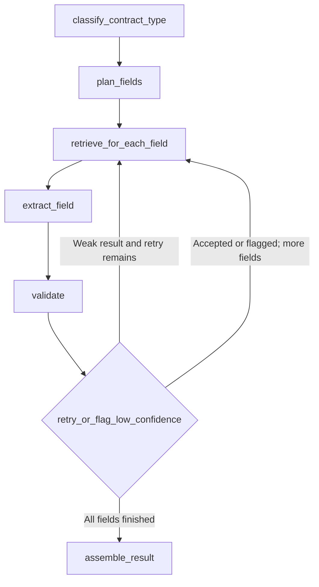

# Step 5: extracting commercial terms

The workflow extracts one field at a time rather than asking the model to fill an
entire contract form in one attempt. It uses the same indexed PDF chunks and exact
page offsets as Step 4. The active provider remains Anthropic, with model and key
read from `.env`. No new API credentials are needed beyond Step 4's configuration.

## Use

Index the PDF with the Step 3 command, re-ingesting older PDFs if Step 4 page offsets
are missing. Then run from the project root:

```powershell
.\.venv\Scripts\python.exe -m app.agent.extract_terms "ID_FROM_INGEST"
```

Optional flags: `--top-k 4` and `--max-retries 1`. A retry count of 1 means at most two
attempts per field. The hard limit is two retries, or three attempts. The same workflow
is exposed through `POST /api/extract` and the interactive `/docs` page:

```json
{
  "doc_id": "ID_FROM_INGEST",
  "top_k": 4,
  "max_retries": 1,
  "confidence_threshold": 0.75
}
```

## Graph



The actual LangGraph node structure is also saved in `terms_workflow.mmd`. Its shared
loop edge represents both retrying the current field and advancing to the next one.

## Simple explanation of the parts

- **State** is the workflow's notebook: document ID, planned fields, current field,
  evidence, candidate value, attempt count, feedback, and completed results.
- **Nodes** are jobs that read that notebook and add results to it.
- **Edges** say which job runs next.
- **Conditional edges** choose a path based on the result. A weak field can go back
  for another search; a completed field advances; the last field leads to assembly.

`classify_contract_type` retrieves title/scope evidence and proposes PPA, EPC, or a
null value for unclear/other/hybrid contracts. This classification is tentative.
`plan_fields` fixes the complete list of 14 requested fields, with contract_type first.
The first loop reuses the classification evidence and draft, then checks and retries
it just like every other field; it does not make a duplicate first-attempt model call.
Only an accepted classification changes subsequent price-search wording: electricity
tariff for a PPA, construction price for an EPC. Uncertain classifications use neutral
queries. All fields are kept for both contract types; missing fields are not guessed.

The remaining loop retrieves for one field, asks for that field's schema, checks the
result, and either retries or saves it. A retry expands top-k, broadens the query with
definitions/schedules/exceptions, retains earlier evidence, and gives the model short
failure feedback. Evidence remains capped by Step 4's 40,000-character limit. A fresh
state is created for each request; fields and document IDs are not shared between runs.

## Output schema

The result contains `doc_id`, `terms`, `needs_review`, and `warnings`. The typed fields
under `terms` are:

| Field | Value type |
| --- | --- |
| contract_type | PPA or EPC |
| parties | List of legal names and roles |
| effective_date | ISO date |
| term_years | Positive number of years |
| COD | Scheduled date, actual date, and milestone/conditions |
| price_tariff | Kind, amount, currency, unit, and pricing basis |
| escalation | Clause text/summary |
| delivery_point | Clause text/summary |
| guaranteed_output | Clause text/summary preserving units and exceptions |
| termination_rights | Clause text/summary |
| liquidated_damages | Clause text/summary preserving rates and caps |
| change_in_law | Clause text/summary |
| force_majeure | Clause text/summary |
| payment_terms | Clause text/summary |

Every field wraps its value with a list of checked source pages and quotes, confidence,
status, reason, and attempt count. Multiple quotes can support a compound field. Example
field (illustrative, not a live model result):

```json
{
  "value": 20,
  "sources": [{
    "doc_id": "contract-A",
    "page": 3,
    "section": "Term",
    "quote": "Initial term: 20 years from COD."
  }],
  "confidence": 0.9,
  "status": "validated",
  "reason": "Initial term starts at COD; optional extensions excluded.",
  "attempts": 1
}
```

Missing values use `value: null`, `sources: []`, and `confidence: 0`. Dates are not
invented from conditions; COD date components can be null with the actual milestone
preserved. A formula or multiple rates can have a null price amount and full details
in `basis`. An unclear whole field has a null value, not a made-up placeholder.

## Validation, retries, and review

Pydantic checks value types, valid dates, numeric ranges and output shape. Source
checking resolves each supplied source ID and verifies its quote on that exact
retrieved page, allowing only whitespace differences. Page numbers come from stored
metadata, never model guesses. The returned source also includes document and section.

Final statuses are:

- `validated`: schema and quote checks passed and confidence meets the threshold.
- `low_confidence`: a sourced value remains below the threshold after retries.
- `not_found`: no value was found in the retrieved evidence.
- `invalid_evidence`: an invented source or quote was rejected; the value is discarded.
- `error`: provider or structured-output failure; the value is discarded.

Every non-validated field appears in `needs_review`. A failed field does not erase
successful fields. Provider failures are not labelled missing contract terms. Repeated
authentication/provider failures can still consume attempts; this is bounded but not
yet optimized with a circuit breaker. Missing credentials return HTTP 503 before work
starts. Old multi-page evidence without offsets returns HTTP 409 and requires re-ingestion.

Confidence is the model's own estimate, not a calibrated probability. A score of 0.9
does not prove 90% accuracy. Real quotes can still be misinterpreted, and compound
values may not be fully supported by the quotes. `validated` does not mean semantic
or legal correctness. Contract-review examples are needed to evaluate that separately.
`not_found` means missing from retrieved evidence, not confirmed absent from the PDF.

## Why LangGraph here?

A single prompt mixes all fields into one result and makes targeted recovery harder.
A plain straight chain works for a fixed sequence, but retrying selected fields needs
branches and loops. LangGraph makes those decisions explicit and testable. The current
graph is easier to inspect without hiding state in nested functions or prompt history.
A normal Python loop could implement this small workflow too; LangGraph is useful as
the workflow grows. It does not automatically make model answers more accurate.

## Tests and scale limits

Tests use controlled model responses and synthetic contract text. They check all 14
fields, PPA/EPC routing, valid dates, source pages, wrong-document isolation, invalid
quotes, retry expansion, confidence flags, provider failures, API responses, and the
maximum retry path. The existing ingestion and vector-store tests cover PDF parsing
and persistence. There is no live extraction-quality claim without a configured API.

At default settings there can be up to 28 logical model calls per document; with two
retries the limit is 42. Empty evidence skips model calls. SDK transport retries may
add HTTP requests. Sequential calls take time and keep an HTTP worker busy. A production
version should use queued jobs, progress reporting, caching, and bounded concurrency.
State currently lives in memory; no checkpointer is configured, so a process crash
loses that run's progress. Durable checkpoints can be added later, but are not claimed
as implemented. Larger documents also need better cross-reference and evidence coverage.

## Interview answers

1. What is state in your graph?
   It is a typed notebook shared between steps: the current field, evidence, retry
   count and completed results. Each step reads it and returns updates.
2. Why a conditional edge?
   The next action depends on validation. Retry a weak field within the limit; otherwise
   accept or flag it and move on. After the final field, assemble the complete response.
3. Why LangGraph instead of one prompt?
   I can retrieve evidence per field, validate separately, retry only failures, and keep
   partial results. That gives clearer control and testing, though it costs more calls.
